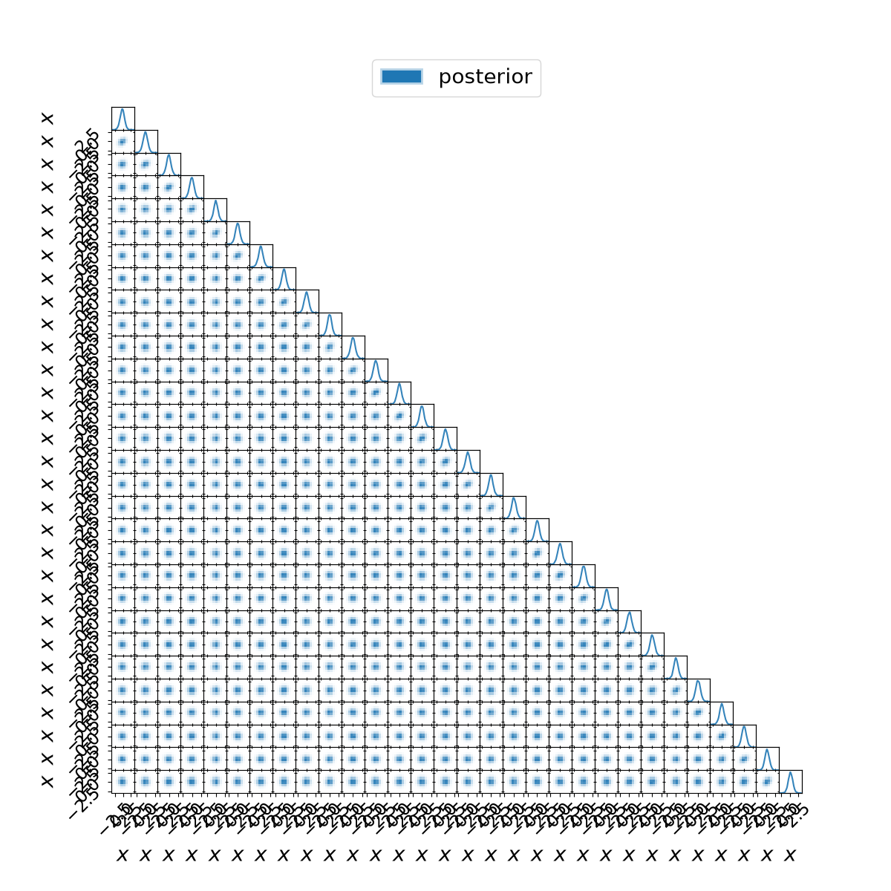

# Compact corner plotting experiment

The array renderer reduced full replay time in both completed pairs while producing byte-identical PNGs. Five cases completed; the host-load guard stopped the final candidate case. The third baseline is unpaired and is excluded from every speedup summary.

| Pair | Backend | Process (s) | Wrapped output (s) | Corner plot (s) | Peak RSS (MiB) |
|---|---|---:|---:|---:|---:|
| 1 | baseline | 149.01 | 133.36 | 102.38 | 535.1 |
| 1 | candidate | 73.68 | 62.51 | 37.54 | 534.9 |
| 2 | candidate | 83.31 | 69.96 | 43.94 | 534.6 |
| 2 | baseline | 111.93 | 101.07 | 73.25 | 534.7 |
| 3 | baseline | 112.30 | 102.54 | 79.47 | 535.3 |

Completed-pair process ratios (baseline / candidate): 2.022x, 1.344x.
The median/range in summary.json use only those two pairs. Timing variation is material; this is exploratory evidence and does not justify changing the default.

All five cases retained all 33,984 weighted samples, the native count of 34,100, unchanged posterior/checkpoint hashes, zero sampler likelihood calls and exactly one separately authorized final-summary timing call. Both matched pairs have identical PNG bytes. The canvas remains 12x12 inches at 100 dpi with every cross-parameter panel and unchanged typography.

Aggregate elapsed time: 535.88s, including preflight, against 1800s. Every completed child stayed within 240s/4096 MiB. Memory is sampled process-group RSS; brief spikes can be missed. The start guard uses one-minute host load <=2 for the eight-CPU affinity. The precise failing host snapshot was not persisted. No automatic retry followed it.

The first attempt stopped before any child because the activation omitted auxiliary package metadata paths. No installed dependency changed. The corrected attempt was explicitly approved; both attempts and all raw data remain retained.

Measured library: e57611dc6; producer: 3bce28c; baseline: bdb7af0e9. A later library guard sends non-string labels back to pandas; the measured string-label drawing path is unchanged. See summary.json for complete frozen source/package identities.

[Library PR](https://github.com/PyAutoLabs/PyAutoFit/pull/1764) · [Experiment PR](https://github.com/PyAutoLabs/autofit_profiling/pull/14). Outside Pulse. Default backend remains anesthetic; merge remains human. This does not resolve 30D evidence accuracy or complete the wider phase 0b.

