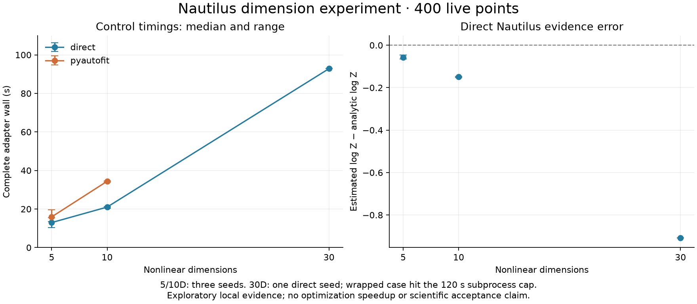

# Nautilus experimental dimension pilot

This is an off-board engineering experiment for [issue #10](https://github.com/PyAutoLabs/autofit_profiling/issues/10), following the [phase-0a baseline](../../wiki/campaigns/nautilus_cpu_baseline.md). It is not a registered Pulse campaign or a scored inference result. Nothing under `experiments/` is ingested by `build_catalogue.py`. Promotion requires a later human decision.

The frozen [protocol](protocol.json) has 36 cases: dimensions 5/10/30 × three seeds × direct/PyAutoFit × tracing off/on. All use 400 live points, ESS target 500, batch 100, four neural networks and one worker with native threads capped at one. Checkpoint and update policies match explicitly. Dimension 5 with 400 live points is a new bridge cell, not a speed comparison with phase 0a's 200-live-point cell.

## Running

Use an isolated environment with the dependencies pinned in protocol.json and activate the detached library paths. From the repo root:

```bash
python scripts/analytic_gaussian/nautilus/campaign.py identity --output output/dimensions-identity.json
python scripts/analytic_gaussian/nautilus/campaign.py plan --identity output/dimensions-identity.json --output output/dimensions-plan.json
python scripts/analytic_gaussian/nautilus/campaign.py run --plan output/dimensions-plan.json --output output/dimensions-run
python scripts/analytic_gaussian/nautilus/experiment_report.py output/dimensions-run --output experiments/nautilus_cpu_dimensions/evidence
```

`plan` uses only the standard library. `identity` imports the runtime, computes analytic truth digests and captures source/content, package, Python, host and affinity identity. Commit measurement code before this step. Pass `identity --preflight-seconds N` to charge preceding timed runtime checks to the 90-minute execution budget. A plan is immutable: rerun the same `run` command to reconcile an interrupted driver, never regenerate the matrix on resume.

Each attempt has a unique directory. Running attempts are durably recorded before launch. Resume refuses a live supervisor, retains interrupted attempts and charges their full timeout conservatively. A previously failed/capped child halts instead of triggering an automatic retry. A selected success is revalidated before resume. The driver holds a nonblocking file lock. It does not run outside the invoking session or schedule future work.

Per-case limit is 120 seconds; total admitted execution plus recorded preflight is at most 90 minutes. The Linux supervisor samples process-group RSS every 50 ms and kills the group at 4 GiB. This is a sampled operational guard, not a kernel-enforced memory quota: sub-interval spikes can be missed and shared pages may be counted more than once. A cap is `memory_cap`, not an inferred OS OOM. At least twice the requested cap must be available. The driver refuses new cases if one-minute load exceeds max(1, affinity CPUs / 4); this observable quiet-host check is not an exclusive scheduler reservation. Do not interfere with other work; noisy or unavailable hosts leave unrun evidence rather than a claimed timing result.

Timeout, memory cap, source mismatch, changed target/configuration or accounting failure stops escalation. Every planned case remains in coverage, including unrun, failed, interrupted and missing results. No failed seed is silently replaced. Traced results require digest-checked timelines and reconciled counts. Missing/partial pairs do not produce overhead ratios; duplicate selected identities fail closed. The historical phase-0a report rejects multiple dimensions rather than reusing its old catalogue IDs; use this experiment exporter for the new matrix.

## Interpretation

Report full adapter wall and subprocess wall separately. Worker times overlap; do not sum them into parent wall. Ratios include host noise and are not corrected. Standardized mean error divides by analytic posterior marginal standard deviation; covariance error is the relative Frobenius norm. ESS and logZ error are diagnostics, not a calibrated scientific acceptance test at three seeds. Native logZ uncertainty and proposal-rejection counts remain unavailable.

Full phase 0b remains incomplete: 60/100/200-dimensional probes, harder targets, worker scaling and parity-admitted lens fixtures need later bounded work. Historical Insight correlated_nd failures concern another family, prior and source pin. Neither these measurements nor their failures are pooled with that campaign. No optimization, release or merge is authorized by running this experiment.

## Measured local pilot — 10 November 2026

[Report](evidence/report.html) · [summary and coverage](evidence/summary.json) · [all attempt receipts](evidence/attempts.json) · [frozen plan](evidence/plan.json)

**Outcome: 26 successes, 1 timeout, 9 unrun cases.** All 13 available trace/control pairs have identical posterior hashes, likelihood counts and run-call cadence. All 12 available cross-adapter pairs match. Five of the 18 planned trace/control pairs have no complete evidence; they are explicitly counted as incomplete. All 13 selected detailed timelines reconcile.

The pilot stopped at the first capped case, as pre-registered: PyAutoFit, 30 dimensions, seed 0, tracing off. The supervisor terminated the process group at 120.05 seconds of subprocess wall and recorded exit 124. Peak sampled RSS was 533.0 MiB, below the 4-GiB limit. Its last logs were result-update/sample-output work, but there is no completed fit receipt. This is not a successful wrapped fit or proof that sampling alone exceeded 120 seconds. Remaining cases were not run, and no cap or settings were changed.

Total charged execution was 940.7 seconds (15.7 minutes), including 71.3 seconds of runtime checks. The code measured was commit `544bc89`; the later report-only change counts wholly missing pairs. Dependency source/content pins and Nautilus source digest match phase 0a. Hardware: Intel Core i9-10885H, WSL exposing four cores/eight logical CPUs, float64 and native math threads set to one. This is a monitored low-load local run, not an exclusive scheduler allocation; the manifest retains load observations.

| Dimensions | Adapter | Control cases | Median wall [min–max], s | logZ error [min–max] |
|---:|---|---:|---|---|
| 5 | direct | 3 | 12.96 [10.33–13.41] | [-0.0642, -0.0453] |
| 5 | pyautofit | 3 | 15.92 [15.59–19.54] | [-0.0642, -0.0453] |
| 10 | direct | 3 | 21.01 [20.49–21.21] | [-0.1520, -0.1474] |
| 10 | pyautofit | 3 | 34.39 [33.91–34.62] | [-0.1520, -0.1474] |
| 30 | direct | 1 | 92.83 [92.83–92.83] | [-0.9081, -0.9081] |
| 30 | pyautofit | 0 complete | subprocess timeout at 120.05 s; adapter wall unavailable | unavailable |

These are dimension-scaling observations at fixed 400-live settings, not optimization speedups. d30 has only one completed direct seed, so no repeated-seed dimensional-robustness claim is possible.

**Accuracy warning:** at d30 the direct search reported ESS 9740.4 and 34,100 likelihood calls, yet logZ was 0.9081 below analytic truth. Both traced and control runs return this same result. Maximum standardized posterior-mean error was 0.0530 and relative covariance Frobenius error 0.1030 for that seed. High ESS and successful termination do not by themselves establish accuracy. Investigating this discrepancy requires a separate, pre-registered correctness experiment; it is not attributed to tracing or diagnosed as a library bug here.

Observed trace/control wall ratios for direct: median 1.042, range 0.876–1.106 (n=7 pairs). Ratios include shared-host noise; a ratio below one does not mean negative instrumentation overhead.

Observed trace/control wall ratios for pyautofit: median 0.976, range 0.833–1.030 (n=6 pairs). Ratios include shared-host noise; a ratio below one does not mean negative instrumentation overhead.

**Next bounded investigation:** retain this baseline and separately test high-dimensional evidence accuracy and end-of-fit output cost. No checkpoint batching, output suppression, neural-network removal or sampler optimization was implemented. Wider dimensions/targets, worker scaling and Pulse promotion remain unstarted.

**Validation:** 66 tooling tests; Ruff lint/format; full-stack analytic-target checks; direct/wrapped × one/two-worker checkpoint/resume equality; traced/control worker-death detection; real subprocess timeout and memory-cap termination; immutable-plan/no-scientific-import test; all-pairs coverage test; unchanged production catalogue and history; links. The runtime-check receipt is [here](evidence/runtime_checks.json). No independent review or scientific acceptance is claimed.


