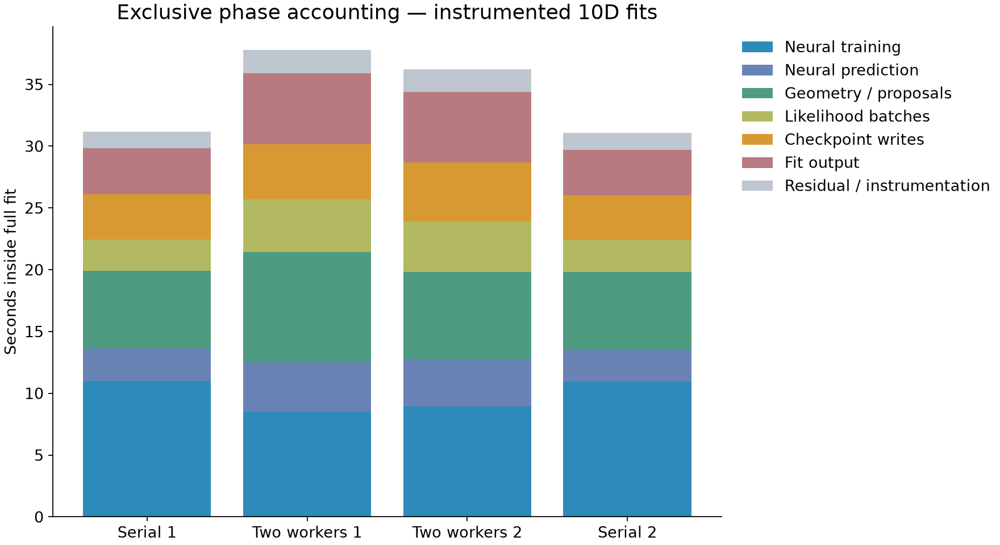
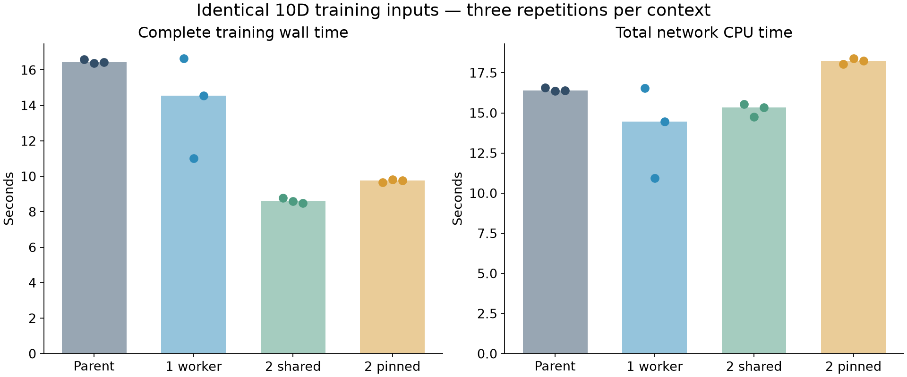

# 10D diagnostic: faster training is outweighed by slower parent CPU work

The reference-node study completed all17 cases with exact parity. For this10D/seed2 case, two training workers saved2.24s in training, but added8.11s elsewhere inside the fit and1.62s in pool lifecycle. Mean instrumented workflow time increased from31.12s to38.61s. The extra time is spread across CPU-heavy parent phases, not extra sampling or checkpoint waiting alone.

This locates the cost but does not identify its hardware/runtime cause. It does not support enabling the training pool by default. The previous5D result remains separate; these are four instrumented10D fits, not a new general speed ranking.

## Completed study and correctness

RAL job415180: COMPLETED0:0 in538s on euclid-ral-compute-1, the exact historical reference node. Measured producerd3a36cf79b5c5dfc073ec64b38595430400798ed. Bootstrap23.92s; scientific supervisor510.59s; maximum child48.30s and592.86MiB sampled process-group RSS. All descendants were reaped and temporary compute-cache cleanup completed. The exclusive job reserved252 scheduler CPUs; the scientific step was bound to four.

One capture,12 training-only replays and four full fits completed. Every fit matched the old posterior, target, model digests,23500likelihood calls,12shells and ESS10038.507608002912 exactly; checkpoint reopening passed. Every replay reproduced all11 captured models exactly with unchanged inputs and zero forbidden sampling/likelihood calls. Phase call counts match across all four fits; exclusive accounting reconciles exactly. All native-library thread counts were one.

The capture on the original node passed the same exact gate that rejected job415179 on another node. That supports the cross-node numerical explanation for attempt01, but does not isolate its underlying floating-point mechanism. No tolerance or reference value was changed.

## Where the fit time goes

Two matched pairs, reversed order: serial/pool/pool/serial. Values below are means of two fits per arm. Full workflow includes startup, fit and teardown; interpreter imports, supervisor work and writing diagnostic receipts are outside it. Instrumentation and its overhead remain inside the measured fits.

| Component | Serial mean (s) | Two-worker mean (s) | Change (s) |
|---|---:|---:|---:|
| Neural training | 10.974 | 8.734 | −2.240 |
| Other work inside fit | 20.139 | 28.253 | +8.114 |
| Full fit | 31.113 | 36.987 | +5.874 |
| Pool startup/teardown | ~0 | 1.619 | +1.619 |
| Full workflow | 31.117 | 38.610 | +7.493 |

Both pairs showed the same direction: workflows31.173→39.380s and31.060→37.839s. The approximately24% mean increase describes these instrumented observations only, not an uninstrumented performance estimate or statistical significance.

The main exclusive phase increases were:

| Phase | Serial wall (s) | Pooled wall (s) | Serial parent CPU (s) | Pooled parent CPU (s) |
|---|---:|---:|---:|---:|
| Likelihood batches, including prior/dispatch | 2.543 | 4.198 | 2.536 | 4.197 |
| Neural prediction | 2.597 | 3.924 | 2.584 | 3.905 |
| Proposal sampling, excluding nested phases | 1.530 | 2.313 | 1.538 | 2.326 |
| Bound geometry, excluding training/prediction | 4.760 | 5.646 | 4.760 | 5.637 |
| Sample output | 2.824 | 4.651 | 2.819 | 4.638 |
| Native checkpoint writes, combined | 3.669 | 4.592 | 2.617 | 3.221 |

Outside neural training, parent-process CPU time increased from19.05s to26.83s: an additional7.78s accompanies the8.11s wall-time increase. This is strong evidence that the main loss is slower CPU execution across several phases. It is not simply more evaluations, more training iterations or a single storage stall. Parent-process CPU includes all parent threads; it is not a strict single-thread wait-time decomposition.

The residual remains explicit: exclusive Sampler.run and full_fit time covers unassigned work and instrumentation. Model validation and checkpoint retention have separate phases. Worker CPU is a separate channel and overlapping worker wall intervals are never added as parent elapsed time.

## Identical-input training replays

Each child replayed the entire11-call corpus using the unchanged native training method and a fresh pool where applicable. Orders were PSUB, BUSP, UPBS; three rounds provide partial order balancing only.

| Context | Median training wall (s) | Median network CPU sum (s) | Median workflow (s) |
|---|---:|---:|---:|
| Parent process | 16.430 | 16.397 | 16.441 |
| One spawn worker | 14.546 | 14.466 | 16.051 |
| Two workers, shared four-core mask | 8.608 | 15.343 | 10.185 |
| Two workers, individually pinned to cores0/1 | 9.754 | 18.254 | 11.438 |

There is no fixed CPU penalty attributable simply to spawning: the one-worker CPU totals were16.544,10.942,14.466s. The two shared workers used slightly less median CPU than the parent replay, whereas they used more aggregate CPU than serial training inside the full fits (15.14s versus10.95s). Even serial parent replay cost differs substantially from serial training within a fit, despite exact model/iteration parity.

Pinning the two workers to cores0/1 did not help in this study; it increased median training wall by13.3% relative to the shared mask. This tests only that specific placement. CPU endpoint observations include the same named guest CPU in both faster and slower cases, so a simple fixed “slow core” explanation is not established. Endpoints are not continuous migration traces.

Both parent and worker processes reported the same two OpenBLAS versions (0.3.34.106.0 and0.3.30), Haswell kernels, and one numerical thread. The guest reports an AMD EPYC7763 and a hypervisor flag. Frequency snapshots/cache counters do not isolate a mechanism. Frequency, cache/SMT effects, memory layout/alignment and host scheduling remain possible explanations, not findings.

## Practical implication and limits

The next useful question is why parent CPU work slows after the training-pool change. More workers, or pinning only the workers to cores0/1, is not supported by this evidence. A separately approved investigation could compare parent/worker CPU placement and runtime state while preserving identical work. It should not assume that process spawning itself causes a constant per-network CPU penalty.

No production/library/default change, extra job, release or merge is authorized by this result. The one-job allowance is consumed. This remains outside Pulse and merge stays human.

## Validation and retained evidence

300 local tests, lint/format/shell/catalogue checks and zero-science descriptor/worker smoke passed; source CI43227695075 passed every step. Author review only. Runtime inventory validation4.18s, fresh artifact14 restore51.19s with zero science and cleanup. Authoritative Heart12:57:11Z was YELLOW: “PyAutoArray: open PR 9d old”; “release validation stale: source moved since rehearsal (PyAutoLens)”. No CI or release gate bypass.

Raw110,486,049bytes are retained on RAL and locally, including all fit outputs, corpus, unverified candidate receipts, successful child receipts, per-task events, phase events and environment metadata. The57,820,758byte compressed archive is also in the human review bundle with checksums. attempt02.json contains compact results, input hashes and archive checksum. Attempt01/job415179, the original job415139 and all earlier evidence remain untouched.
